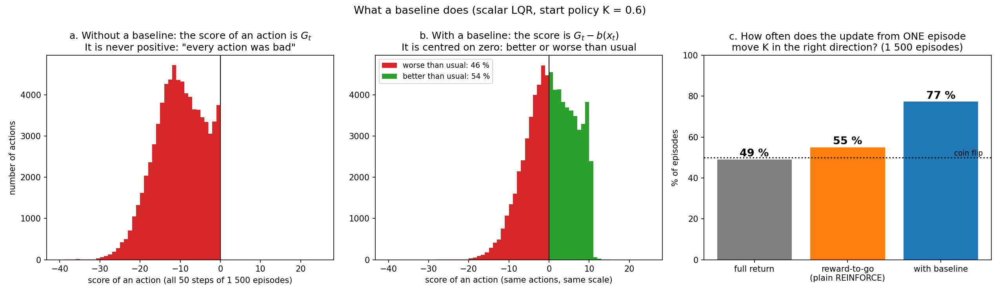
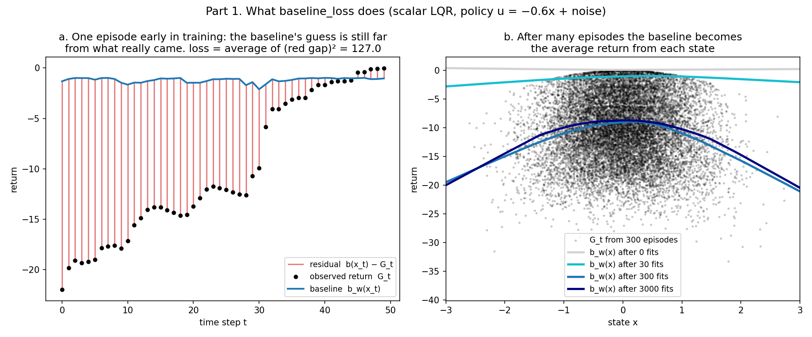
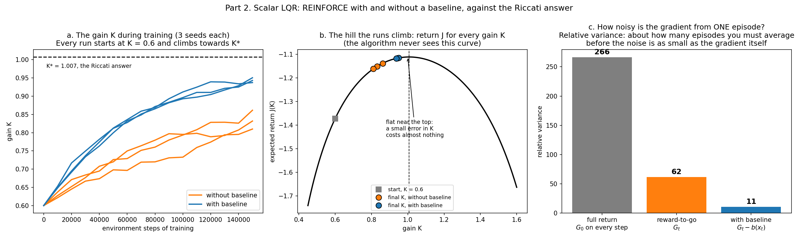
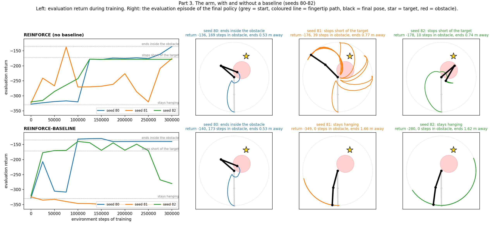
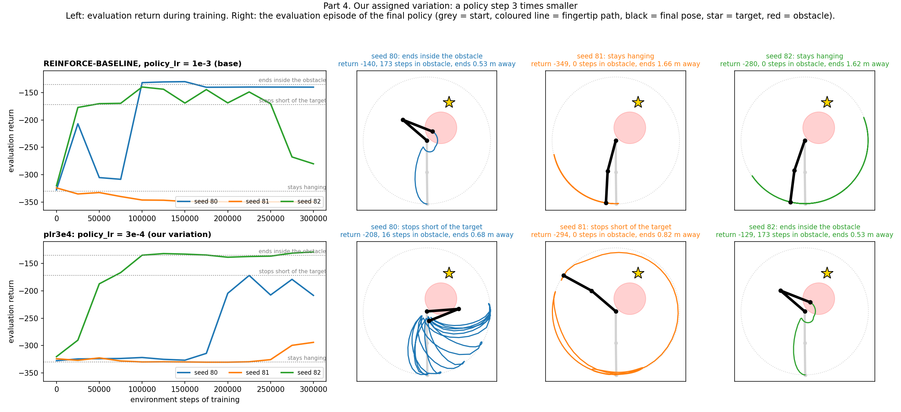
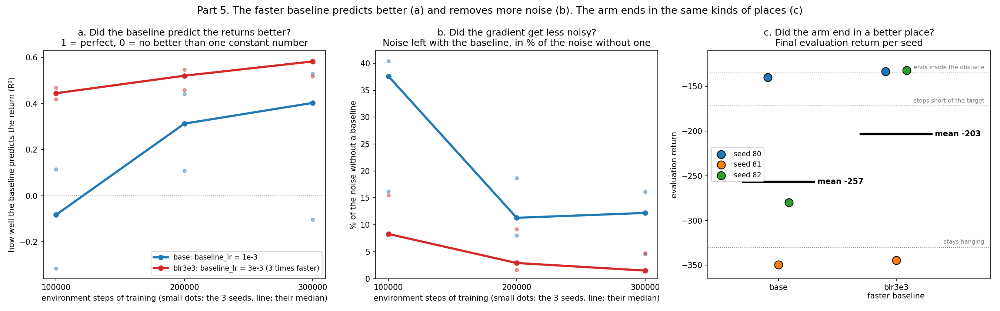
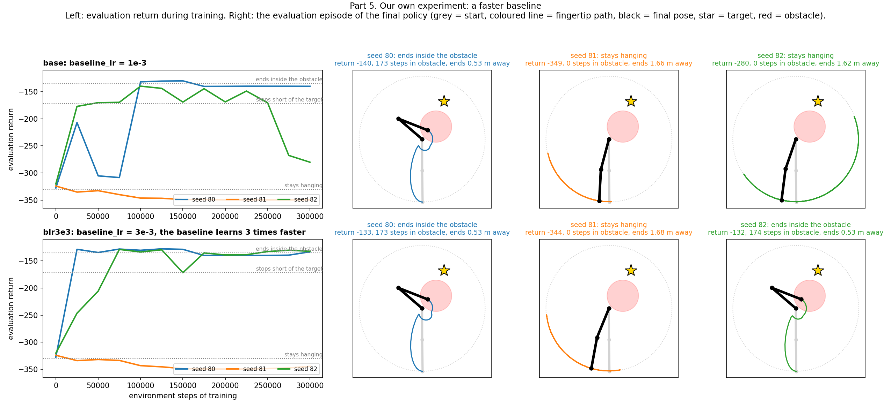
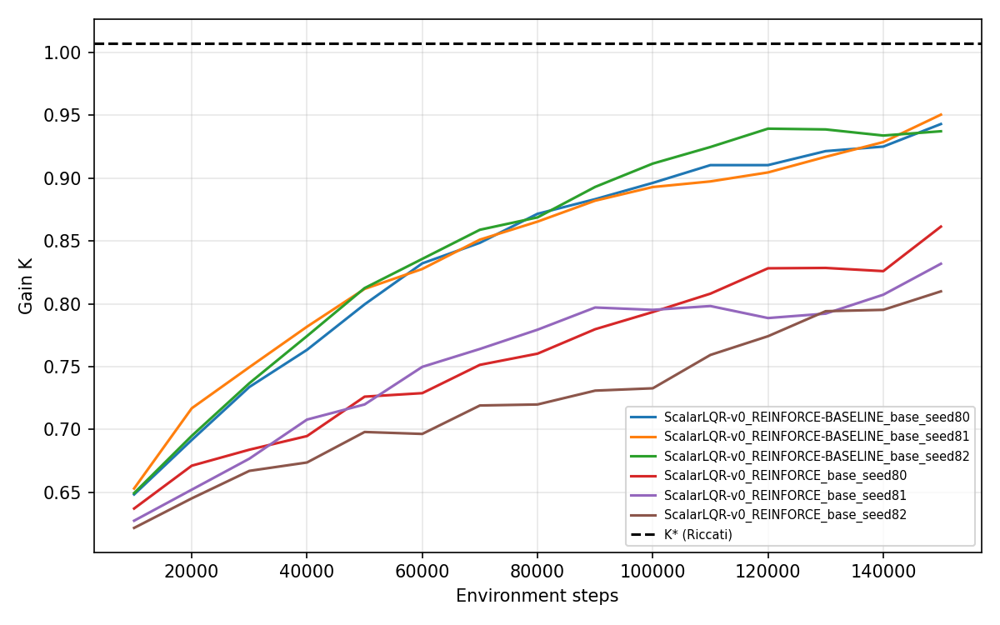
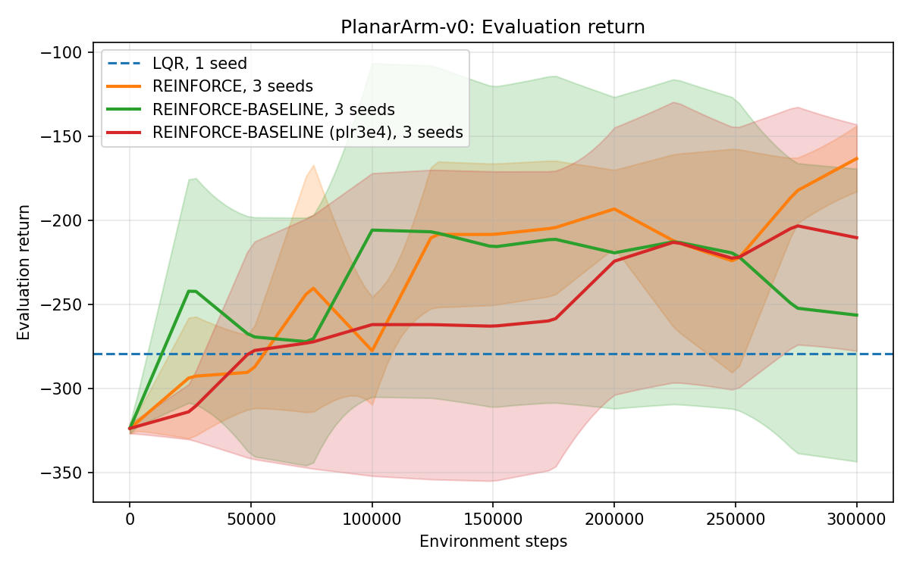
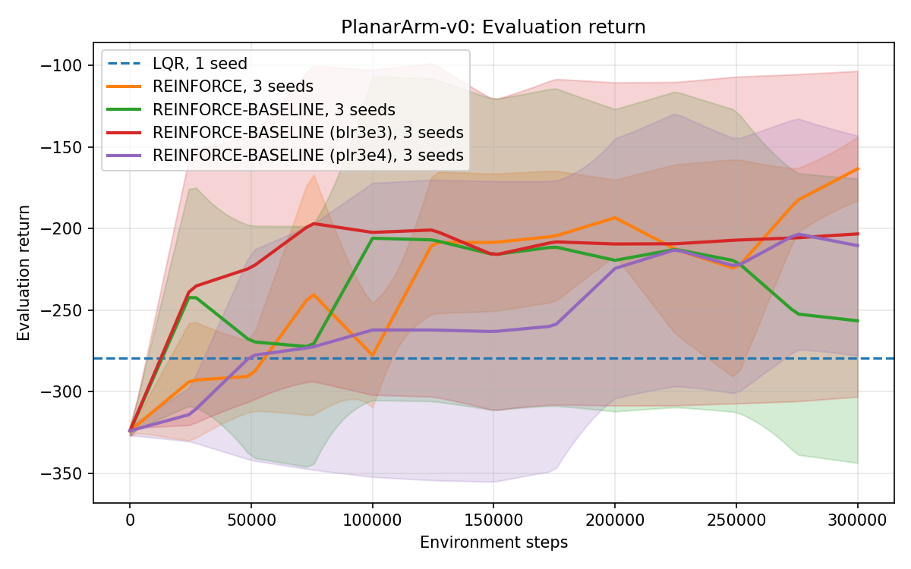

# Homework 1: REINFORCE with and without a baseline

Group 8, seeds 80, 81 and 82. This file follows the six parts of `briefs/brief_w09_reinforce.md`. Open it with **Ctrl+Shift+V** to see the figures.

## The short version

1. **What a baseline is.** A guess of "how well does it usually go from this state". We subtract it from the return, so each action is judged against *usual* instead of against zero.
2. **On the scalar LQR it works as the lecture says.** The gradient is about 6 times less noisy with the baseline, and the gain ends closer to the Riccati answer: 0.94 against 0.83, with $K^\star = 1.007$.
3. **On the arm the gradient also gets less noisy, but the result did not get better.** Plain REINFORCE scored −164 ± 20. With the baseline: −257 ± 87.
4. **No run reaches the target.** Every run ends in one of three dead ends: it stays hanging, stops short, or ends inside the obstacle. The trained policies push at full torque until a joint hits its end stop. Part 3 explains why.
5. **Our variation `plr3e4`** (smaller policy steps) learned later on two seeds and ended at −211 ± 67. No clear gain.
6. **Our own experiment `blr3e3`** (the baseline learns 3 times faster). We predicted: a better baseline gives less noise, so a better arm. The baseline did get better and the noise did fall. The arm did not clearly improve: one seed of three changed its ending.
7. **How sure we are.** Not very, on the arm. With 3 seeds, one seed changing its dead end moves the mean by 50 to 70.

## Theory you need (Week 9 deck)

**The idea of REINFORCE.** Play one episode with a policy that adds random noise to its actions. Then make the actions that were followed by a high return more likely.

**The problem** is what the deck calls failure mode 2, high variance:

> "Two rollouts from the same state under the same policy can return values that differ by more than the difference between a good action and a bad one."

**The fix** is the frame "REINFORCE with a baseline". It changes three lines of the algorithm:

| Deck line | In words | In our code |
|---|---|---|
| 5: $G \leftarrow r_{t+1} + \gamma G$ | Add up the rewards that came after step $t$ | `reward_to_go` |
| 6: $\delta \leftarrow G - b_w(x_t)$ | Was this better or worse than usual from this state? | `baseline_delta` |
| 7: move $b_w(x_t)$ towards $G$ | Teach the baseline what "usual" is | `baseline_loss` |
| 8: move the policy by $\delta \, \nabla \log\pi$ | Make $u_t$ more likely if $\delta > 0$, less likely if $\delta < 0$ | `policy_loss` |

**Two sentences from the deck that explain most of our results:**

> "The choice of b moves the variance and leaves the mean where it was."

> "Variance is down; the episode count, the discarded data and the exploration are where they were."

So a baseline makes each step less noisy. It does not change where the steps point on average, and it does not make the policy explore more.



- **a.** Without a baseline, the score of an action is the return that followed it. All our rewards are negative, so every score is negative: every action is told it was bad.
- **b.** With a baseline, the same actions get a score around zero: about half were better than usual, half worse.
- **c.** That matters for learning. Without a baseline, the update from one episode moves the gain in the right direction about half the time, like a coin flip. With the baseline: 77 % of the time.

## 1. Complete the code

**What we wrote** in `models/reinforce_baseline.py`:

```python
delta_t = returns - baseline_values.detach()               # baseline_delta
loss = torch.mean((baseline_values - returns) ** 2)        # baseline_loss
```

**Check:** `python -m unittest tests.test_c1_baseline tests.test_c1_variance` passes, and so do all 44 tests.



- **a.** The black dots are the returns that really came in one episode. The blue line is the baseline's guess. The loss is the average squared gap (red). Early in training the guess is still far off.
- **b.** Every episode moves the guess a little towards the returns. After many episodes the baseline (dark blue) runs through the middle of the cloud: it has become the average return from each state.

**Why $(b - G)^2$ and not $b^2 - G^2$?**
The loss must be smallest when the guess equals the return. $(b-G)^2$ is zero exactly there. $b^2 - G^2$ is smallest at $b = 0$, which teaches nothing.

**Why `.detach()`?**
The baseline is only a reference number for the policy step. The policy step must not change the baseline. See question 3 in part 6.

## 2. Scalar LQR, against the Riccati answer

**The problem.** One number $x$ that grows by itself: $x_{k+1} = 1.1\,x_k + u_k$. The policy is $u = -Kx$ plus noise. The Riccati equation gives the best gain, $K^\star = 1.007$. So here we can check the learning against a known answer.

**What we ran.** REINFORCE and REINFORCE-BASELINE, 3 seeds each, 3 000 episodes, all starting at $K = 0.6$.



| | Seed 80 | Seed 81 | Seed 82 | Below $K^\star$ |
|---|---|---|---|---|
| Final $K$, REINFORCE | 0.861 | 0.832 | 0.810 | 15 to 20 % |
| Final $K$, REINFORCE-BASELINE | 0.943 | 0.950 | 0.937 | 6 to 7 % |

| Gradient estimate | Relative variance | Did its average move? |
|---|---|---|
| Full return on every step | 266 | no |
| Reward-to-go $G_t$ | 62 | no |
| With baseline $G_t - b(x_t)$ | 11 | no |

**Conclusion.** The baseline works exactly as the lecture says. The gradient is 6 times less noisy than reward-to-go, its average did not move, and in the same 3 000 episodes the gain gets clearly closer to $K^\star$.

**What does "relative variance 266" mean?**
Roughly: you would have to average about 266 episodes before the noise is as small as the gradient itself. With the baseline, about 11.

**Why is no run exactly at $K^\star$?**
Near the top the hill is flat (panel b), so the slope is tiny and the noise drowns it. Progress gets slow. Less noise means faster progress, which is why the baseline runs are further along.

**Why do all runs score the same return (−0.9)?**
Because the top is flat. A gain of 0.83 or 0.94 costs almost nothing compared with 1.007.

**Why does this work so well here?**
The deck: on LQR, gradient descent "converges to the Riccati gain $K^\star$, with no local minima to be trapped by". There is one hill. Noise is the only obstacle.

## 3. The project arm

**The problem.** A two-link arm hangs down and must bring its fingertip to the star.

- **The motor is too weak to lift the arm straight up.** Holding it out sideways needs 9.8 N m at the shoulder; the motor gives 6. The arm has to swing, or fold its elbow first, to get up.
- **An obstacle sits between the start and the target.**
- **The reward is minus the distance to the target**, minus a small penalty on torque. Steps inside the obstacle are counted separately as *cost*. They do not lower the reward.
- **No Riccati answer exists.** The reference is an LQR controller built around the target. It scores −279 and stays near hanging.

**What we ran.** Both algorithms, 3 seeds each, 1 500 episodes.



**How to read it.** Each row is one algorithm. Left: the evaluation return of the three seeds during training. Right: what the final policy of each seed does, from hanging (grey) to its final pose (black).

**Every run ends in one of three places:**

| Ending | Return | What the arm does |
|---|---|---|
| Stays hanging | −280 to −350 | Swings a little near the bottom, never gets up |
| Stops short of the target | −165 to −180 | Gets up, stops about 0.75 m from the star |
| Ends inside the obstacle | −130 to −140 | Folds up with the fingertip in the obstacle, 0.53 m from the star |

The obstacle ending has the *best* return, because the reward does not punish the obstacle.

| | Seed 80 | Seed 81 | Seed 82 | Mean ± std |
|---|---|---|---|---|
| REINFORCE | −136 | −176 | −178 | **−164 ± 20** |
| REINFORCE-BASELINE | −140 | −349 | −280 | **−257 ± 87** |

**Conclusion.** On our seeds plain REINFORCE did better, by 93 on average. Two of the three baseline runs ended hanging. The spread of the baseline runs (±87) is almost as large as the difference.

**Did the baseline lower the noise on the arm too?**
Yes. `gradient_variance.py` gives 1 256 (full return), 753 (reward-to-go) and 14 (baseline). The first two are probably too low, because 1 000 episodes cannot pin down the average gradient of 4 600 parameters; the direction of the result is not in doubt.

**Then why did the baseline not win?**
The arm is not one hill. It has dead ends, and the lecture says what the baseline leaves alone: "the exploration [is] where [it was]". A cleaner gradient walks more surely up *whatever hill the run is on*. It does not pick a better hill.

**Can a run get worse during training?**
Yes. Baseline seed 82 (green) sat at −170 for 250 000 steps and then dropped to hanging. Each update changes the controller, and a small change can break the swing-up.

### Why does no run reach the target?

Holding the arm at the star is physically easy: it needs only 6 % of the shoulder's torque and 48 % of the elbow's. The policies never learn to do that. We checked the 12 final policies of parts 3, 4 and 5:

- **They push as hard as they can.** Most of them command full torque, or more, on most steps.
- **They stop only when a joint hits its end stop.** In all 12, at least one joint ends pressed against its mechanical limit. In the black poses above, the folded elbow and the raised shoulder are at their limits.

Four reasons this happens:

1. **Pushing harder than full torque switches off the exploration.** The environment cuts every command off at full torque. Once the policy asks for more than that, adding noise changes nothing: the arm gets full torque either way. So the algorithm never sees that "a bit less torque" would be better, and cannot learn to brake or to hold still.
2. **Getting closer means getting worse first.** From the folded pose in the obstacle, 0.53 m from the star, the arm would have to unfold and swing round. Every small change makes the distance bigger first. REINFORCE only tries small changes around what it already does. The deck: "the policy still explores only through its own randomness".
3. **The reward does not mind the obstacle.** It only measures distance, so folding into the obstacle is a quick way to a good score.
4. **Far too few episodes for this method.** We train for 1 500 episodes, 300 000 steps. In the deck, REINFORCE on the simpler pendulum swing-up used 6.5 million steps "without converging". We have 20 times less data on a harder problem.

## 4. Our assigned variation: `plr3e4`

**What changed.** Group 8 gets variation 1: `policy_lr=3e-4` instead of `1e-3`. Each policy update is about 3 times smaller. The baseline is unchanged.



| | Seed 80 | Seed 81 | Seed 82 | Mean ± std |
|---|---|---|---|---|
| Base (`policy_lr=1e-3`) | −140 | −349 | −280 | −257 ± 87 |
| `plr3e4` | −208 | −294 | −129 | −211 ± 67 |

**Conclusion.**

- **Learning starts later.** Seed 80 stays hanging until 175 000 steps and seed 81 until 250 000. That fits smaller steps: the policy moves a third as far per update.
- **The endings changed, but not in one direction.** Seed 80 got worse (obstacle → stops short), seed 82 got better (hanging → obstacle), and seed 81 only just starts to get up.
- **No clear gain.** The mean is 46 better, with spreads of ±67 and ±87.

## 5. Our own experiment: `blr3e3`

### What we changed, in plain words

The baseline learns from every episode: it moves its guess a little towards the returns it just saw. `baseline_lr` is the size of that move. We made it 3 times larger, `3e-3` instead of `1e-3`, so the baseline learns "what is usual" sooner. Nothing else changed.

### The four lines for the oral

**Change.** `baseline_lr=3e-3` (default `1e-3`), named `blr3e3`.

**Prediction** (24 November 2026, before the runs). In our words: *"I would try to minimize the variance, which the baseline already does, but it doesn't always seem to find the optimal, so I would be looking at … changing the baseline_lr … to represent the value better."* As a chain:

> baseline learns faster → it predicts the returns better → the gradient is less noisy → the arm ends in a better place

**Result.**



- **a.** How well the baseline predicts the returns, on a scale where 1 is perfect and 0 is no better than one fixed number. Red (ours) is above blue (base) the whole time.
- **b.** How much noise is left in the gradient, compared with using no baseline. Red is below blue the whole time.
- **c.** Where each seed ended. The dotted lines are the three endings of part 3.



| | Base | `blr3e3` |
|---|---|---|
| Baseline predicts the returns ($R^2$), at the end | 0.40 | **0.58** |
| Noise left after 100 000 steps | 38 % | **8 %** |
| Noise left at the end | 12 % | **2 %** |
| Return, seeds 80 / 81 / 82 | −140 / −349 / −280 | −133 / −344 / −132 |
| Return, mean ± std | −257 ± 87 | −203 ± 100 |
| Endings | obstacle, hanging, hanging | obstacle, hanging, obstacle |

**Explanation.**

- **The first three steps of the chain held.** The faster baseline predicts better at every checkpoint, and it leaves about 8 times less noise at the end (1.5 % against 12 %).
- **The last step did not clearly hold.** Seed 80 ends in the same place. Seed 81 still hangs, with a flat curve from start to end. Only seed 82 changed, from hanging to inside the obstacle. That lifts the mean by 53, but the spread is ±100: it rests on one seed.
- **"Better" here is not the goal either.** The seed that improved ends inside the obstacle. The reward likes that; the task does not.
- **Why less noise was not enough.** The deck says a baseline "moves the variance and leaves the mean where it was". It makes each step cleaner but does not change where the steps lead. The arm's problem is the dead ends and the full-torque pushing of part 3, and a cleaner gradient does not get a run out of those. On the LQR, where noise is the only problem, the same idea works.
- **Did the baseline learn too fast?** The brief asks this for `1e-2`. At our `3e-3` we see no sign of it: the fit is better at every checkpoint.

### Two things to correct in our first idea

- **The baseline estimates the value of the *current* policy**, not of the best one. It cannot "find the optimum" itself; only the policy can.
- **$\gamma$ is the discount, not a learning rate.** We first called it one. It sets how far ahead rewards count.

## 6. The pre-session questions

Short answers from our runs, with the plot to show for each. Say them in your own words: the session is with our runs on screen, without notes, and any of us can be asked.

### Question 1

> Show the gain plot from part 2. What final $K$ did you reach with and without the baseline, and how far is that from $K^\star$?



**How to read it.** Each line is one run. Left to right is training time. The height is the gain $K$ at that moment. The dashed line at the top is the Riccati answer, $K^\star = 1.007$. The three upper lines are the runs with a baseline, the three lower ones without.

**Answer.** Without the baseline: 0.86, 0.83, 0.81. With it: 0.94, 0.95, 0.94. So without the baseline we end 15 to 20 % below $K^\star$, with it 6 to 7 % below. All runs climb from 0.6 and none passes $K^\star$.

### Question 2

> What relative variance did you measure for the three estimators on LQR, and did the means move?

**Show** the output of `python experiments/gradient_variance.py --run runs/ScalarLQR-v0_REINFORCE_base_seed80`:

```
estimator          relative variance    parameters beyond 2 s.e.
full return                    266.2                          0%
reward-to-go                    61.7                          0%
baseline                        10.7                          0%
```

**How to read it.** Each row is one way to estimate the gradient from an episode. "Relative variance" is how noisy it is. The last column counts the policy's numbers whose average changed; 0 % means the average did not move.

**Answer.** 266, 62 and 11. Each step makes the estimate less noisy, and the means did not move. That is what theory says: both changes subtract something whose average is zero, so only the noise changes.

### Question 3

> Open your `baseline_delta`. Why does it detach the baseline, and what would go wrong if it did not?

**Show** `models/reinforce_baseline.py`:

```python
delta_t = returns - baseline_values.detach()
```

**Answer.** The baseline is a fixed reference number for the policy step. `.detach()` cuts it out of the gradient, so the policy step cannot change the baseline. Without it:

- *in theory*, the policy loss would also push on the baseline's weights. The baseline would stop estimating "the usual return", and the noise reduction would be lost;
- *in our code*, training crashes on the first episode ("Trying to backward through the graph a second time"). We tested this.

### Question 4

> Show the comparison on the arm. Which did better on your seeds, and by how much?



**How to read it.** Each line is the average evaluation return of 3 seeds during training; higher is better. The shaded band is the spread between the seeds. Orange is plain REINFORCE, green is with the baseline, red is our variation `plr3e4`, and the dashed line is the LQR controller, which does not learn.

**Answer.** Plain REINFORCE ends at −164 ± 20, the baseline at −257 ± 87. REINFORCE was better on every seed (by 4, 173 and 102). Two baseline runs ended hanging. The baseline did lower the variance (753 → 14), but the arm has dead ends, and less noise does not get a run out of one. The wide bands show how much the seeds disagree. The part 3 figure shows where each seed ended.

### Question 5

> What did your assigned variation change?

**Show** the same plot, red line, and the part 4 figure.

**Answer.** `policy_lr` from `1e-3` to `3e-4`: policy steps 3 times smaller. The red line rises later than the others: learning started later on two seeds. The final mean is −211 ± 67 against −257 ± 87. No clear gain, and each seed ended somewhere different.

### Question 6

> What was your own experiment: your prediction, your result, and why they agree or differ?



**How to read it.** The same kind of plot, now with our experiment `blr3e3` as an extra line.

**Show** this plot and the two part 5 figures.

**Answer.** The four lines of part 5. In one breath: we made the baseline learn 3 times faster. We predicted a better baseline, less noise, and so a better arm. The baseline did predict better and the noise fell (2 % left instead of 12 %). The arm did not clearly improve: one seed of three changed its ending. The baseline changes the noise, not where the steps lead, and the arm's problem is dead ends.

**Did any of the changes we tried improve the result?** On the average return, yes; reliably, no.

| Setting | Return, mean ± std | Runs left hanging | Against base (−257 ± 87) |
|---|---|---|---|
| Baseline learns 3 times **slower** (`baseline_lr=3e-4`) | **−161 ± 15** | 0 of 3 | best and most consistent |
| Bigger baseline network, (128, 128) | −194 ± 62 | 0 of 3 | better; one seed ended 0.32 m from the star, the closest of any run |
| Baseline learns 3 times **faster** (`blr3e3`) | −203 ± 100 | 1 of 3 | better on one seed |
| Training twice as long (600 000 steps) | −255 ± 87 | 2 of 3 | no change |

- **Every change to the baseline scored higher than base on average.** The slower baseline did best, which is the opposite of our prediction: it predicts the returns *worse* and leaves *more* noise.
- **None of them beat plain REINFORCE** (−164 ± 20), and none reached the star.
- **We cannot call any of them a real improvement.** Each result rests on 3 seeds, and one seed changing its ending moves the mean by 50 to 70.
- **More training did not help at all.** A run that is stuck stays stuck.

## What Week 10 adds (actor-critic)

Everything in this homework uses the Week 9 method. Week 10 teaches the next method, called actor-critic. We did not run it. It does help to understand three of our results.

### 1. Our "better or worse than usual" has an official name

In our code, $\delta$ is the return minus the baseline. Week 10 calls the thing this measures the **advantage** of an action. The deck's definition:

> "how much better taking u at x is than what π does there on average"

In plain words: if the advantage is positive, the action was better than what the policy normally does in that state. If it is negative, it was worse.

### 2. A critic is a baseline that learns in a different way

**Our baseline (Week 9) waits until the episode is over.** Then it looks at the return that really came and moves its guess towards it. That return is a sum of up to 200 rewards, each a little random. So the baseline learns from a very noisy number.

**A critic (Week 10) does not wait.** After every single step it takes the one reward it just got and adds *its own guess* for the state it landed in. It learns from that. Learning from your own guess is called **bootstrapping**.

- **What that buys:** much less noise. Only one step of randomness is involved, not a whole episode.
- **What it costs:** the critic's own guess is part of what it learns from. While that guess is still wrong, it is learning from something wrong. The deck calls this a **bias**. Our baseline does not have this problem; it only has the noise.
- **The link to our runs:** the deck warns that the critic is poor early in training. Our baseline was too. In part 5 (panel a) it predicts the returns badly during the first 100 000 steps.

### 3. Week 10 confirms why the arm got stuck

Our finding was: a better baseline made the gradient cleaner, but the arm stayed in its dead ends, because the policy never tries anything really different.

The Week 10 notes say the same about the critic:

> "mode 4, exploration, is untouched by the construction."

"Mode 4" is the course's name for *not exploring enough*. So a better baseline does not make the policy explore more, and neither does a critic.

For that problem the deck names a different tool, an **entropy term**. It gives the policy a small extra reward for keeping its actions varied, so that it keeps trying new things. In the deck's words: "Entropy buys exploration".

## Where everything is

Everything is under `output/week10/`, one folder per part of the brief:

| Folder | What is in it |
|---|---|
| `homework1_summary.md`, `homework1_summary.pdf` | This file, and a PDF of it (`python output/week10/scripts/make_pdf.py` remakes both PDFs) |
| `theory/` | The figure of the theory section |
| `part1_code/` | The `baseline_loss` figure |
| `part2_lqr/` | Our figure, and what the brief's commands made: `lqr_gain.png` (question 1), the LQR comparison plot, the variance measurement |
| `part3_arm/` | Our figure, and what the brief's commands made: the arm comparison plot (questions 4 and 5), the variance measurement, the fingertip path |
| `part4_variation/` | Our figure for `plr3e4` |
| `part5_own_experiment/` | Our two figures, the measurements behind them, and the comparison plot with `blr3e3` (question 6) |
| `scripts/` | `make_figures.py` redraws the part 2 to 5 figures. `baseline_quality.py` is the measurement of part 5. Two small scripts draw the theory and part 1 figures |
| `deep_dive/` | Optional: a longer note on how one training run works, with more maths and detailed figures, also as a PDF |

The training runs themselves are in `runs/` at the top of the project, where `train.py` puts them.

The course scripts write to a folder `outputs/` by default. To keep things here, tell them where to write, for example `python compare.py --env PlanarArm-v0 --out-dir output/week10/part3_arm` or `python experiments/lqr_gain.py "runs/ScalarLQR-v0_REINFORCE*" --out output/week10/part2_lqr/lqr_gain.png`.
