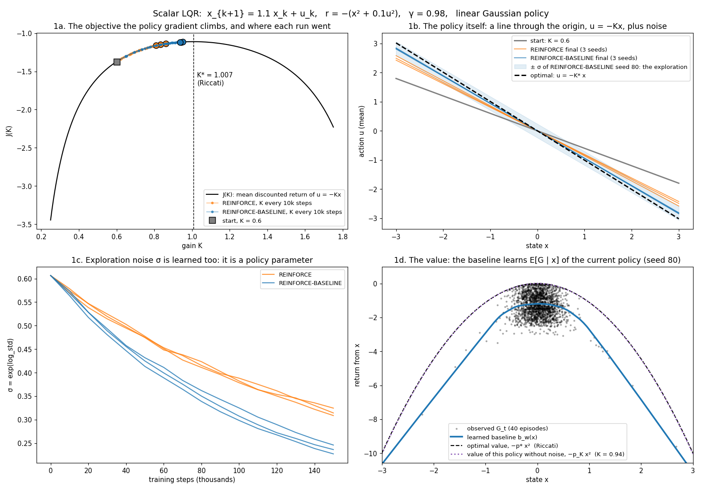
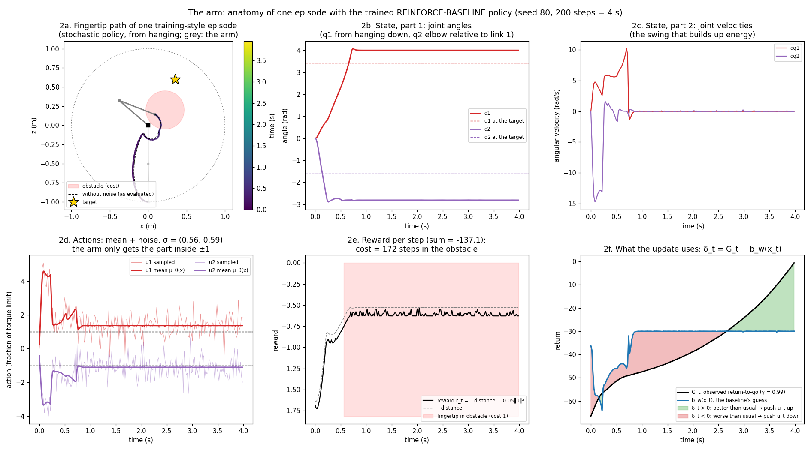
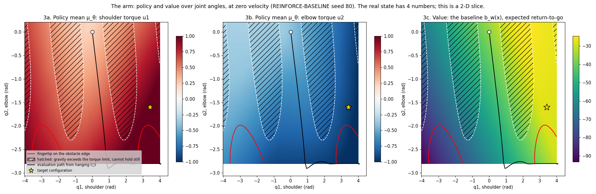
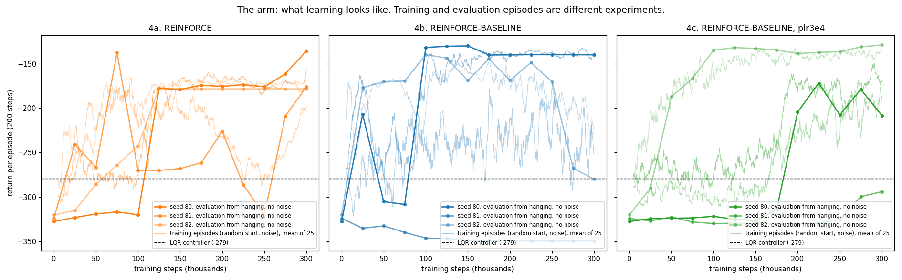
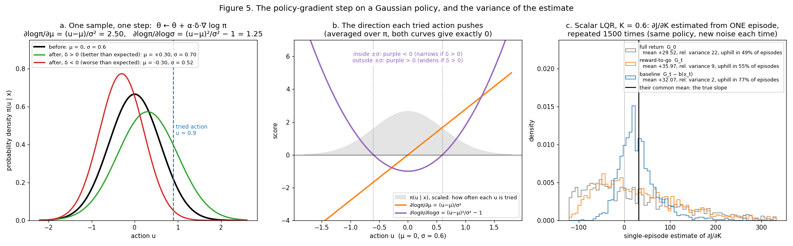
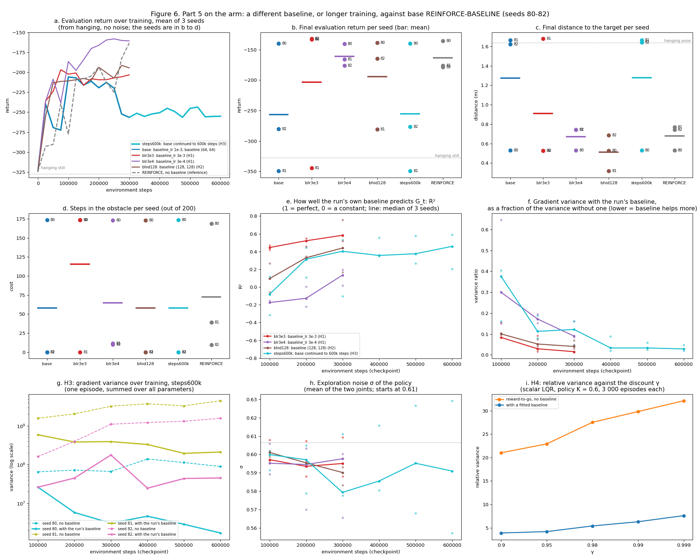

# How a training run works: REINFORCE with a baseline

What happens when you type

```
python train.py --algo REINFORCE-BASELINE --seed 80 --steps 300000 --eval-every 25000
```

Every figure below is drawn from our own runs in `runs/` (group 8, seeds 80 to 82). To redraw them after new runs, use `python output/week10/explain_runs.py`. Open this file with **Ctrl+Shift+V** to see the formulas and figures.

## 1. The loop, step by step

**The problem** is a Markov decision process. The state is $x$, the action is $u$, the dynamics are $x_{k+1} = f(x_k, u_k)$, and each step gives a reward $r$. The agent never sees $f$: it only plays and observes. That is what *model-free* means.

**The policy** is a Gaussian around a network's output:

$$\pi_\theta(u \mid x) = \mathcal N\big(\mu_\theta(x),\ \operatorname{diag}(\sigma^2)\big), \qquad \sigma = e^{\texttt{log\_std}}$$

Both the network weights and $\log\sigma$ are in $\theta$, so the amount of exploration is learned too.

**One episode** (`harness/training.py`, `agent.update`):

1. At every step: sample $u_t \sim \pi_\theta(\cdot \mid x_t)$. The environment applies $\operatorname{clip}(u_t, -1, 1)$ and returns $r_{t+1}$ and $x_{t+1}$. The agent stores $(x_t, u_t, r_{t+1})$.
2. At the end of the episode (`_learn_from_episode`):

| Step | Mathematics | Code |
|---|---|---|
| Return-to-go | $G_t = r_{t+1} + \gamma G_{t+1}$, computed backwards from $G_T = 0$ | `reward_to_go` |
| Advantage estimate | $\delta_t = G_t - b_w(x_t)$, using $w$ as it was before this episode | `baseline_delta` |
| Baseline step | $w \leftarrow w - \alpha_w \nabla_w \frac1T \sum_t \big(b_w(x_t) - G_t\big)^2$ | `baseline_loss` + Adam |
| Policy step | $\theta \leftarrow \theta + \alpha_\theta \frac1T \sum_t \gamma^t\, \delta_t\, \nabla_\theta \log \pi_\theta(u_t \mid x_t)$ | `policy_loss` + Adam |

The code *minimises* $-\frac1T\sum_t \gamma^t \delta_t \log\pi_\theta$ because optimisers minimise. A descent step on that loss is an ascent step on the return.

**What "push $u_t$ up" means for a Gaussian.** For one action dimension, $\log\pi = -\frac{(u-\mu)^2}{2\sigma^2} - \log\sigma + \text{const}$, so

$$\frac{\partial \log\pi}{\partial \mu} = \frac{u-\mu}{\sigma^2}, \qquad \frac{\partial \log\pi}{\partial \log\sigma} = \frac{(u-\mu)^2}{\sigma^2} - 1 .$$

With $\delta_t > 0$, the mean moves *towards* the action that was tried. The spread grows if that action was far from the mean ($|u-\mu| > \sigma$) and shrinks if it was close.

**Evaluation** runs every `--eval-every` steps and is a separate experiment. It plays 20 episodes on fixed seeds (1000 to 1019), uses the mean action $\mu_\theta(x)$ with **no noise**, and on the arm always starts **from hanging**. It reports the **undiscounted** sum of rewards. That is the line printed during training:

```
step   300000 | return -140.1 | cost 173.4 | distance 0.529 | training time 212.1 s
```

Here *return* is the mean over the 20 episodes, *cost* is the mean number of steps the fingertip spent in the obstacle, and *distance* is how far the fingertip is from the target at the last step.

**What a run saves** (`runs/<env>_<algo>_<variation>_seed<S>/`): `results.npz` with every evaluation and the return of every training episode, `final.pt` with the policy and the baseline, and `step_*.pt` checkpoints when you pass `--checkpoint-every`.

**How many updates.** The arm: 300 000 steps ÷ 200 steps per episode = **1 500 episodes**, so 1 500 policy steps and 1 500 baseline steps. Scalar LQR: 150 000 ÷ 50 = **3 000** of each.

## 2. Scalar LQR, where the answer is known (Figure 1)



**The system:** $x_{k+1} = a x_k + b u_k$ with $a = 1.1$ and $b = 1$. The reward is $r = -(q x^2 + r_u u^2)$ with $q = 1$ and $r_u = 0.1$. The discount is $\gamma = 0.98$, the start is $x_0 \sim \mathcal N(0,1)$, and an episode lasts 50 steps. With $|a| > 1$ the plant is unstable without control.

**The policy.** With `hidden_sizes=()` the network is a single linear layer, so

$$u = -Kx + \sigma\varepsilon, \qquad \varepsilon \sim \mathcal N(0,1),$$

and `initial_gain=0.6` starts it at $K = 0.6$. The closed loop is $x_{k+1} = (a - bK)\,x_k + b\sigma\varepsilon_k$, stable while $|a - bK| < 1$.

**1a. The objective.** Without noise, the expected discounted return of a gain $K$ is

$$J(K) = -(q + r_u K^2)\ \mathbb E[x_0^2] \sum_{k=0}^{49} \big(\gamma (a-bK)^2\big)^k .$$

This is the black curve. REINFORCE never sees this formula: it estimates the curve's slope from sampled episodes and takes a step uphill. Each dot is the gain of one run at a 10k-step checkpoint, so you can watch every run climb from $K = 0.6$ (the square) towards the top. The optimum comes from the discounted Riccati equation:

$$p = q + \gamma a^2 p - \frac{(\gamma a b p)^2}{r_u + \gamma b^2 p}, \qquad K^\star = \frac{\gamma a b\, p}{r_u + \gamma b^2 p} = 1.007 .$$

`experiments/lqr_gain.py` prints the final $K$ of each run and draws it against $K^\star$ over training (`outputs/lqr_gain.png`).

**1b. The policy itself** is a line through the origin with slope $-K$. Learning rotates the line from the grey start towards the dashed optimum. The shaded band is $\pm\sigma$: the actions actually tried around the mean.

**1c. The exploration noise** $\sigma$ falls in every run. Use the $\partial\log\pi/\partial\log\sigma$ formula from section 1 to work out why.

**1d. The value.** For a fixed gain without noise the value is quadratic:

$$V_K(x) = -p_K x^2, \qquad p_K = \frac{q + r_u K^2}{1 - \gamma (a-bK)^2},$$

and $V^\star(x) = -p^\star x^2$ is the optimum; at $K = 0.94$ the two curves almost coincide. The black dots are observed returns $(x_t, G_t)$, and the blue curve is what the baseline learned from such returns. Three things to notice:

- Near $x = 0$ it sits *below* $-p_K x^2$. Even from $x = 0$, the noise $\sigma\varepsilon$ keeps pushing the state away, and every step away costs reward. (Late steps pull the other way: with little episode left, their $G_t$ is closer to 0.)
- Beyond $|x| \approx 1.5$ it is a straight line. That is the ReLU network extrapolating where it has seen almost no states.
- It is a regression on observed returns, not a Bellman solution: nothing is bootstrapped.

## 3. The arm (Figures 2 to 4)

**State** $x = (q_1, q_2, \dot q_1, \dot q_2)$: $q_1$ is the shoulder angle from hanging straight down, $q_2$ the elbow angle relative to the first link. Each link is $L = 0.5$ m long, so the fingertip is at

$$p(q) = L \begin{pmatrix} \sin q_1 + \sin(q_1+q_2) \\ -\cos q_1 - \cos(q_1 + q_2) \end{pmatrix}.$$

**Action and torque:** $\tau = (6\,u_1,\ 5\,u_2)$ N m, with $u$ clipped to $[-1, 1]$.

**Reward** $r = -\lVert p - p_\text{target}\rVert - 0.05\lVert u\rVert^2$ with $p_\text{target} = (0.35, 0.6)$. **Cost** is 1 while $\lVert p - c\rVert < 0.25$, with $c = (0.22, 0.2)$. The reward ignores the cost.

**The physics the agent never sees:** MuJoCo integrates $M(q)\ddot q + C(q,\dot q)\dot q + g(q) + d\,\dot q = \tau$ in 0.01 s substeps, two per step, so 50 Hz. Holding the arm still needs $\tau = g(q)$, with

$$g_2 = m g \tfrac L2 \sin(q_1+q_2), \qquad g_1 = m g \tfrac{3L}{2} \sin q_1 + g_2 .$$

Outstretched horizontally, $g_1 = 9.81$ N m, more than the shoulder's 6 N m. So the arm cannot lift itself straight up. It has to swing and build up energy: the hatched bands in Figure 3.

**Starts:** training episodes start from a random pose at rest; evaluation always starts from hanging.

**Networks:** the policy is $4 \to 64 \to 64 \to 2$ (the means) plus 2 log-stds. The baseline is $4 \to 64 \to 64 \to 1$.

### Figure 2: one episode, from the inside



One episode with the trained seed-80 policy, sampled with noise as in training but from hanging. The dashed path in 2a is the same policy without noise, as in evaluation.

- **2a.** The fingertip path in the vertical plane, coloured by time. The grey sticks are the arm at a few instants.
- **2b, 2c.** The state: angles and velocities. The dashed lines in 2b are the target configuration.
- **2d.** The actions. The thick lines are the means $\mu_\theta(x_t)$; the thin lines are the sampled $u_t$ that the update uses. The environment applies only the part inside the dashed $\pm 1$ lines.
- **2e.** The reward at each step; red marks the steps inside the obstacle.
- **2f.** The quantity the policy update multiplies $\nabla\log\pi$ by: $\delta_t = G_t - b_w(x_t)$. Green steps make their action more likely, red steps less likely.

The baseline is a function of the **state only**, and time is not part of the state. Near the end of the episode, $G_t$ goes to 0 because few steps are left. The baseline gives a resting state the same value at any time, so part of $\delta_t$ is "how much episode is left", not "how good was $u_t$".

### Figure 3: the policy and the value as maps



The state has 4 numbers, so these maps are slices: every joint-angle pair with **zero velocity**.

- **3a, 3b.** The mean torque each joint would apply. Red is positive, blue negative, saturated beyond $\pm 1$.
- **3c.** The baseline, the expected return-to-go from each pose.
- **Overlays:** the black line is the evaluation path from hanging (○); the star is the target configuration $q^\star = (3.42, -1.61)$; red curves mark the obstacle edge; hatching marks the poses the motors cannot hold against gravity.

### Figure 4: what learning looks like



Two different measurements of the same run:

- **Thin lines:** the training episodes, from random starts with noise, averaged over 25 episodes.
- **Dots:** the evaluations, from hanging without noise, every 25k steps.

The dashed line is the LQR controller from `python train.py --algo LQR`. `python compare.py --env PlanarArm-v0` puts the evaluation curves of all experiments in one plot (`outputs/comparison_PlanarArm-v0_return_steps.png`).

## 4. Check your understanding

These are for you to work out; they are not the oral questions.

1. In 2d the mean torques sit outside $\pm 1$ for most of the episode. What does the arm actually receive then, and what is left of the exploration that $\sigma$ was supposed to provide? What does $\partial\log\pi/\partial\mu = (u-\mu)/\sigma^2$ still do to $\mu$ when the action is clipped anyway?
2. In 2b, where do the two joints end up, and is that the target? Why could a gradient method stay there?
3. In 2f, why is $\delta_t$ red in the middle and green at the end, even though the arm hardly moves after 1 s?
4. In 1c, $\sigma$ falls in every run. Using $\partial\log\pi/\partial\log\sigma$, what kind of episodes make it fall?
5. In Figure 4, training curves and evaluation curves disagree. Which part of the difference comes from the start state, and which from the noise?
6. In 1d the baseline is far from $-p_K x^2$ for $|x| > 1.5$. Does that hurt the policy gradient? How often are those states visited?

## 5. Questions and answers

Questions from our study session of 24 November 2026, with the answers. Figure 5 belongs to questions 4 to 6; `python output/week10/explain_gradient.py` redraws it.



### Q1. Model-free

> Here we state we don't know $f$, however we observe the current and future state and the input to see the effect of the input on the state? Also, what does not-model-free RL mean, or doesn't this exist?

Yes. Every step shows the agent a sample of $f$: the tuple $(x_t, u_t, r_{t+1}, x_{t+1})$. *Model-free* does not mean the agent sees nothing of the dynamics. It means the agent never builds or uses a formula or an estimate of $f$. It learns the policy straight from returns.

REINFORCE goes further: its update uses only $x_t$, $u_t$ and $G_t$. The next state $x_{t+1}$ matters only as the state where the next action is taken. Here is why $f$ is not needed:

$$\log p_\theta(\tau) = \log p(x_0) + \sum_t \log \pi_\theta(u_t \mid x_t) + \sum_t \log p(x_{t+1} \mid x_t, u_t)$$

Only the middle sum depends on $\theta$, so $\nabla_\theta \log p_\theta(\tau) = \sum_t \nabla_\theta \log \pi_\theta(u_t \mid x_t)$. The dynamics drop out of the gradient; this is the log-derivative trick. They still shape the returns we observe: the plant computes the expectation over $f$ for us.

Model-based methods do exist, in two kinds:

- **The model is given:** dynamic programming, Riccati/LQR and MPC. Our project has two. `--algo RICCATI` uses $a = 1.1$ and $b = 1$ directly. `--algo LQR` (`baselines/lqr.py`) linearises the MuJoCo step around the target and solves the discrete Riccati equation. Both are control design, not learning.
- **The model is learned:** fit $\hat f$ from the observed $(x_t, u_t, x_{t+1})$, then plan with it or generate imagined data from it (Dyna, MBPO, PILCO). This is Week 11. It needs far fewer samples but brings model bias: the controller exploits the model's errors.

### Q2. Why a Gaussian policy

> Why do we have a policy that is a Gaussian around a network's output? Is this only for RL? It is like it could be any of these, but we are not sure which one, as there could be different kinds of dynamics at play here?

The randomness does not express uncertainty about the dynamics. It is noise injected on purpose into what the agent does, for two reasons:

1. **Exploration.** To find out which direction is better, the agent must try actions a little different from its current best guess.
2. **The estimator needs it.** The gradient is $\nabla J = \mathbb E\big[\sum_t \nabla \log\pi \, G_t\big]$. A deterministic policy $u = \mu(x)$ has no $\log\pi$ to differentiate; we would need $\partial f/\partial u$ and $\partial r/\partial u$ instead, which is a model.

In control terms this is **persistent excitation**, as in system identification: inject a rich input so the data contain information about what the input does.

**Why a Gaussian in particular:** it fits continuous actions, it is cheap to sample, and $\log\pi$ and its gradients have closed forms. It also gives two knobs per joint:

- **$\mu_\theta(x)$, the network output,** is the controller: where to aim, depending on the state.
- **$\sigma = e^{\texttt{log\_std}}$** is how far to look around that aim. It is learned, the same in every state, and starts at $e^{-0.5} = 0.61$.

Other distributions work as well. Discrete actions use a categorical distribution. Bounded actions can use a Beta or a tanh-squashed Gaussian, which is relevant here because the arm clips at $\pm 1$. Mixtures handle several modes. Any distribution with a differentiable log-density works with REINFORCE. Nor is this only RL: evolution strategies, the cross-entropy method and system identification perturb with Gaussians too.

"It could be any of these, we are not sure which" is close in spirit, since $\sigma$ shrinks as the policy improves, but $\sigma$ is not a belief. In a fully observed MDP the best policy is deterministic; the noise is only a tool for gathering information.

### Q3. The four functions of the update

> These functions [the table in section 1], what do they mean within what we are doing in this practical? I understand we use them, but why and how exactly?

They run once per episode, in this order, in `_learn_from_episode`. A worked example with 3 steps, $\gamma = 0.9$ and rewards $(-2, -1, -0.5)$:

| $t$ | $r_{t+1}$ | $G_t$, computed backwards | $b(x_t)$ | $\delta_t = G_t - b(x_t)$ |
|---|---|---|---|---|
| 2 | −0.5 | −0.5 | −0.2 | **−0.30** |
| 1 | −1 | $-1 + 0.9 \cdot (-0.5) = -1.45$ | −2.0 | **+0.55** |
| 0 | −2 | $-2 + 0.9 \cdot (-1.45) = -3.305$ | −3.0 | **−0.305** |

- **`reward_to_go`** gives each action its score. Action $u_t$ can only affect the rewards after it (causality), so it is judged by $G_t$ and not by the whole return. On the arm, $G_0$ sums 200 rewards.
- **`baseline_delta`** asks whether the outcome was better or worse than usual from this state. Here $\delta_1 = +0.55$: after step 1 things went better than $b$ predicted, so $u_1$ becomes more likely, and $u_0$ and $u_2$ become less likely. $b$ is computed with the weights from *before* this episode's fit. Why the function calls `.detach()` is oral question 3 (section 8).
- **`baseline_loss`** is a regression: $(0.305^2 + 0.55^2 + 0.30^2)/3 = 0.16$. Over all functions, its minimiser is $b(x) = \mathbb E[G_t \mid x_t = x] = V^\pi(x)$, the value of the *current* policy. The baseline has its own network and its own Adam optimiser (`baseline_lr`). See `baseline_loss_explained.png`.
- **`policy_loss`** $= -\frac1T \sum_t \gamma^t \delta_t \log\pi(u_t \mid x_t)$ is a *surrogate*: its value means nothing, and only its gradient matters. That gradient is minus the estimate of $\nabla J$, so Adam descending on it climbs $J$. The factor $\gamma^t$ comes from the discounted objective: with $\gamma = 0.99$, the arm's last step weighs $0.99^{199} \approx 0.14$.

### Q4. What the baseline changes

> How does the baseline affect the results? What if it wasn't there?

Without it, $\delta_t = G_t$. Every reward in both problems is negative, so every $G_t < 0$. Each episode then says "every action was bad, push them all down", by an amount set mostly by where the episode started (on the LQR, $G_0 \approx -p\,x_0^2$) and hardly by which actions were tried.

On average these pushes cancel, because $\mathbb E[\nabla \log\pi] = 0$ (Figure 5b). So the estimate is still unbiased, but in any single episode the pushes do not cancel, and the leftover is noise.

The baseline removes the part of $G_t$ that can be predicted from the state. It adds no bias:

$$\mathbb E_u\big[b(x)\, \nabla \log\pi(u \mid x)\big] = b(x)\, \mathbb E_u[\nabla \log\pi] = 0,$$

because $b$ depends on $x$ and not on $u$.

Figure 5c shows this at the LQR start policy, $K = 0.6$. All three estimators have the same mean, but the step from one episode points uphill in **49 %** of episodes with the full return, **55 %** with reward-to-go and **77 %** with the baseline. Our own measurement is in section 6, and on the LQR it matches the final gains: 0.94–0.95 with the baseline against 0.81–0.86 without, after the same 3 000 episodes. On the arm, the evaluation returns did not follow the variance numbers. Explaining that is oral question 4; Figure 2 and questions 1–3 of section 4 are where to look.

### Q5. The Gaussian score formula

> What does this formula do? Why is it there and how is it used?
> $$\frac{\partial \log\pi}{\partial\mu} = \frac{u-\mu}{\sigma^2}, \qquad \frac{\partial \log\pi}{\partial\log\sigma} = \frac{(u-\mu)^2}{\sigma^2} - 1$$

**Derivation.** Start from $\log\pi = -\frac{(u-\mu)^2}{2\sigma^2} - \log\sigma - \tfrac12 \log 2\pi$:

- Differentiating with respect to $\mu$ gives $(u-\mu)/\sigma^2$.
- For $\sigma$, write $\sigma = e^s$. The term $-(u-\mu)^2 e^{-2s}/2 - s$ gives $(u-\mu)^2 e^{-2s} - 1 = (u-\mu)^2/\sigma^2 - 1$.

**Where it is used.** $\theta$ holds the network weights and $\log\sigma$. By the chain rule,

$$\nabla_{\text{weights}} \log\pi = \frac{u-\mu}{\sigma^2}\, \nabla_{\text{weights}}\, \mu_\theta(x).$$

For the linear LQR policy $\mu = -Kx$ this is $\partial \log\pi/\partial K = -x(u-\mu)/\sigma^2$. The code never writes these formulas: `log_prob(u)` followed by `backward()` computes exactly them. What they give us is a reading of what each step does (Figure 5a and 5b):

- **$\mu$** moves towards actions with $\delta > 0$ and away from actions with $\delta < 0$. The size scales with $1/\sigma^2$, so the smaller $\sigma$ gets, the bigger the push from the same deviation.
- **$\sigma$** grows when a far action (beyond $\pm\sigma$) did well or a near one did badly, and shrinks in the opposite cases. In 5a, with $\mu = 0$, $\sigma = 0.6$ and $u = 0.9$, the two scores are 2.50 and 1.25. With $\delta > 0$, $\mu$ goes to 0.30 and $\sigma$ to 0.70; with $\delta < 0$, $\mu$ goes to −0.30 and $\sigma$ to 0.52.
- **Both scores average to zero under $\pi$**, because $\mathbb E[u-\mu] = 0$ and $\mathbb E[(u-\mu)^2] = \sigma^2$. That is exactly why the baseline adds no bias (Q4).

### Q6. Where the variance comes from, and why random exploration

> Variance with the baseline goes down, right? Why is there variance in the first place? Because we introduce a Gaussian, does this then function as the exploration of the learning step? Why would we use noise to explore and not something more structured, purely because we don't know the model? Why wouldn't anything else work?

Yes, it goes down: section 6 has the numbers. The variance is that of the **gradient estimate**, not of the policy. Each episode gives one random estimate $\hat g$. Its average over infinitely many episodes is the true $\nabla J$, and the spread around that average is the variance (Figure 5c). The spread has four sources:

1. **The action noise $\sigma\varepsilon$.** Yes, that is the exploration.
2. **The random start:** $x_0 \sim \mathcal N(0,1)$ on the LQR, a random pose on the arm.
3. **Plant noise.** There is none in either environment, but a real robot has it.
4. **One episode is one sample**, and $G_t$ sums up to 50 or 200 random terms.

The noise is the exploration **and** the measurement. The estimator correlates the perturbation $(u-\mu)$ with the outcome $\delta$, like a randomised finite difference: try a little more and a little less, and see which went better. It is the price of having no model. With $\partial f/\partial u$ we could differentiate through the dynamics with zero noise, as iLQR does. Nor can $\sigma$ simply be made tiny: the score grows as $1/\sigma$, so the variance grows as $1/\sigma^2$.

**Why random and not structured?** Independent Gaussian noise covers every direction equally and has a known density, and those two properties make the Week 9 theory exact. Structured exploration exists and often works better:

- **Time-correlated noise** (Ornstein–Uhlenbeck, pink noise). White noise at 50 Hz is largely filtered out by the arm's inertia. In Figure 2d the sampled $u$ jumps every step while the angles in 2b barely react.
- **Parameter-space noise and evolution strategies.** Perturb $\theta$ once per episode, so the behaviour stays consistent within the episode.
- **Directed exploration:** UCB, Thompson sampling, curiosity. The course lists these against "insufficient exploration".
- **Model-based exploration:** explore where the learned model is unsure.

Each of these needs its own estimator. White Gaussian noise is simply the simplest one the theory covers.

### Q7. What part 3 does differently

> The arm experiment is different? Or what does this do here in step 3?

It uses the same algorithm and the same code on a different plant. Part 2 calibrates the method on a problem with a known answer. Part 3 is the project problem, where no closed-form answer exists, so we compare against a reference controller instead.

| | Scalar LQR (part 2) | Planar arm (part 3) |
|---|---|---|
| State / action | $x$ / $u$, unbounded | $(q_1, q_2, \dot q_1, \dot q_2)$ / $(u_1, u_2)$ clipped to $\pm 1$, giving 6 and 5 N m |
| Dynamics | linear: $x^+ = 1.1x + u$ | MuJoCo: gravity, coupling, torque limits |
| Reward | $-(x^2 + 0.1u^2)$ | $-\text{distance} - 0.05\lVert u\rVert^2$; obstacle steps counted separately as *cost* |
| Policy | linear: $K$, a bias and $\log\sigma$ (3 numbers) | $4 \to 64 \to 64 \to 2$ network plus 2 $\log\sigma$ (about 4 600 numbers) |
| Episode, $\gamma$ | 50 steps, $\gamma = 0.98$ | 200 steps, $\gamma = 0.99$; random start in training, hanging start in evaluation |
| Reference | RICCATI: the exact optimum $K^\star = 1.007$ | LQR linearised at the target: a reference, not the optimum |

The arm's LQR reference describes itself as "good near the target and fails from the hanging start", because the linear model knows nothing about the torque limits. Our data show this: LQR ends 1.59 m from the target, and the hanging fingertip is 1.64 m away.

The part 3 commands: `compare.py` puts all evaluation curves in one plot. `gradient_variance.py` repeats the part 2 measurement on the arm. `watch.py --path` draws the trained policy's fingertip path.

### Q8. Reading Figure 2

> I am not sure what I am looking at in Figure 2. Is it the arm mechanism in RL compared to the optimal model solution?

There is no optimal solution in it; for the arm we cannot compute one. Figure 2 is a flight recorder of **one episode of our trained RL policy** (REINFORCE-BASELINE, seed 80). The episode starts from hanging, as in evaluation, with the noise on, as in training. So it shows exactly the data that one update would use.

Two things in it are references:

- **The dashed path in 2a** is the same policy *without* noise, which is what evaluation scores.
- **The dashed lines in 2b** are the target configuration $q^\star = (3.42, -1.61)$: the joint angles that put the fingertip on the star, from inverse kinematics. They are a target, not a controller.

Read it as a story over 4 s:

- **0 to 0.25 s:** both torques saturate (2d) and the elbow folds fast ($\dot q_2 \approx -15$ rad/s in 2c).
- **0.25 to 0.75 s:** the shoulder swings up from 0 to 4.0 rad.
- **After 0.75 s:** everything stops. The joints rest at $(4.0, -2.8)$, not at the dashed lines, and the fingertip sits in the obstacle (red in 2e, 172 steps of cost).
- **2f:** the $\delta_t$ this episode would feed into the update.

*Why* it stops there is questions 1–3 of section 4.

## 6. Results of parts 2 to 4

These are the numbers the brief's scripts printed. Interpreting them is ours to do in the session (section 8).

**Scalar LQR.** $K^\star = 1.007$. Every final evaluation return is −0.9, the same as the Riccati optimum.

| Seed | Final $K$, REINFORCE | Final $K$, REINFORCE-BASELINE |
|---|---|---|
| 80 | 0.861 | 0.943 |
| 81 | 0.832 | 0.950 |
| 82 | 0.810 | 0.937 |

**Gradient variance**, from `experiments/gradient_variance.py` at the policy of REINFORCE seed 80, as relative variance $(\mathbb E\lVert g\rVert^2 - \lVert\mathbb E g\rVert^2)/\lVert\mathbb E g\rVert^2$:

| Estimator | LQR | Arm |
|---|---|---|
| Full return | 266.2 | 1255.9 |
| Reward-to-go | 61.7 | 753.1 |
| Baseline | 10.7 | 14.3 |

On the LQR, no estimator's mean differed from the full-return mean by more than 2 standard errors on any parameter. On the arm, 2 % of the parameters did with the baseline.

**A caution about the two arm values without a baseline.** The formula divides by the squared mean of the samples. When the episodes cannot pin that mean down, which happens with about 4 600 parameters and 1 000 episodes, the result sits near the number of episodes whatever the truth is. So 1255.9 and 753.1 probably underestimate the true values. The arm baseline value (14.3) and all the LQR values are far below that limit, so they are fine.

**Arm**, final evaluation, from hanging and without noise:

| Run | Seed 80 | Seed 81 | Seed 82 | Mean ± std |
|---|---|---|---|---|
| LQR (no learning) | | | | return −279.4, cost 0, distance 1.593 |
| REINFORCE, return | −135.9 | −176.1 | −178.4 | −163.5 ± 19.5 |
| REINFORCE, cost / distance | 168.7 / 0.529 | 38.9 / 0.768 | 9.6 / 0.741 | 72.4 / 0.679 |
| REINFORCE-BASELINE, return | −140.1 | −349.4 | −280.0 | −256.5 ± 87.1 |
| REINFORCE-BASELINE, cost / distance | 173.4 / 0.529 | 0.0 / 1.665 | 0.0 / 1.623 | 57.8 / 1.272 |
| `plr3e4`, return | −208.3 | −294.1 | −129.1 | −210.5 ± 67.4 |
| `plr3e4`, cost / distance | 16.2 / 0.680 | 0.0 / 0.820 | 172.6 / 0.527 | 62.9 / 0.676 |

## 7. Part 5: our own experiment

### 7.1 What the brief asks

Four lines for the oral:

1. **Change:** one setting, different from our assigned variation.
2. **Prediction:** written *before* the run, with the reason from theory.
3. **Result:** a plot on at least 2 seeds.
4. **Explanation:** why the prediction held or failed.

A wrong prediction we can explain scores as well as a right one. The rules:

- **One setting, not our variation:** no `policy_lr`.
- **Not the brief's exact example values:** `initial_gain=0.0`, `initial_gain=1.3`, `baseline_lr=1e-2` and `"hidden_sizes=()"`.
- **A name without an underscore.**
- **The theory must have been shown in class.**

### 7.2 What we can change, and what each setting does

These are the mechanisms each setting acts through. Which of them wins on our runs is the prediction, and that part is ours to make.

**`baseline_lr`**, default $10^{-3}$. Not $10^{-2}$ (the brief's example) and preferably not $10^{-4}$ (group 5's variation). It is $\alpha_w$ in $w \leftarrow w - \alpha_w \nabla_w \frac1T \sum_t \big(b_w(x_t) - G_t\big)^2$, applied once per episode: 1 500 steps on the arm.

- **The target moves.** $V^\pi$ changes whenever the policy changes, so $b$ has to keep up. A baseline that lags leaves a systematic offset in $\delta_t$.
- **Each step sees one episode only:** 200 correlated samples from one start. A large step pulls $b$ towards that episode's returns, noise included, and Adam can overshoot.
- **Adam moves each weight by about $\alpha_w$ per step**, whatever the size of the gradient. A new network outputs about 0, and the arm's returns lie tens below 0.
- **Neither direction adds bias:** $\delta_t$ uses $b$ from before this episode's fit, so $b$ never depends on this episode's actions.

**`"baseline_hidden_sizes=(A,B)"`**, default (64, 64): the size of the baseline network $4 \to A \to B \to 1$. This is a different setting from `hidden_sizes`, the policy's network (groups 6 and 7).

- **Capacity.** A smaller network can represent less of $V^\pi$ over the 4-D state. A larger one can represent more, but has more weights to fit with the same 1 500 single-episode steps.
- **What no size can fix.** The baseline sees only $x_t$, never the time left in the episode, and $G_t$ depends on time too (Figure 2f).
- **No bias in either direction.**

**`--steps`**, 300 000 by default, which is 1 500 episodes. More episodes means more updates of both networks. The variance of one estimate depends on the policy at that moment, not on how many steps came before it. What changes the variance during training is the policy itself, for example $\sigma$, because the score scales with $1/\sigma$. This is an argument of `train.py` rather than a `--set` setting, and it doubles the time; check with the teacher that it counts.

**On the scalar LQR**, keeping the other part 2 settings:

- **`initial_gain`** starts elsewhere on the $J(K)$ curve of Figure 1a. The closed loop is stable for $0.1 < K < 2.1$.
- **`baseline_lr`** acts through the same mechanisms as on the arm.
- **`gamma`** moves $K^\star$ itself, but `lqr_gain.py` and RICCATI keep drawing the $\gamma = 0.98$ value. A new $K^\star$ would have to be computed by hand from the Riccati equation in section 2.

**Not for us:** `policy_lr` is our part 4. `gamma` and `hidden_sizes` on the arm are allowed at other values, but groups 3, 4, 6 and 7 already show them in the session. The initial $\sigma$ is fixed in `utils/networks.py` and cannot be changed with `--set`.

### 7.3 How to run, plot and check

For each seed $S$ in 80, 81 and 82, with `NAME` our name and one of the two `--set` options:

```
python train.py --algo REINFORCE-BASELINE --seed S --steps 300000 --eval-every 25000 --variation NAME --set baseline_lr=VALUE
python train.py --algo REINFORCE-BASELINE --seed S --steps 300000 --eval-every 25000 --variation NAME --set "baseline_hidden_sizes=(A,B)"
```

Then:

```
python compare.py --env PlanarArm-v0 --out-dir outputs/part5
python compare.py --env PlanarArm-v0 --out-dir outputs/part5 --metric distance
python compare.py --env PlanarArm-v0 --out-dir outputs/part5 --metric cost
python output/week10/baseline_quality.py runs/PlanarArm-v0_REINFORCE-BASELINE_NAME_seed80 runs/PlanarArm-v0_REINFORCE-BASELINE_NAME_seed81 runs/PlanarArm-v0_REINFORCE-BASELINE_NAME_seed82
```

- **`compare.py`** plots the evaluation curves of every experiment (mean and spread over seeds) and prints a table of final values. `--out-dir outputs/part5` leaves the part 3 and 4 plots in `outputs/` unchanged.
- **`baseline_quality.py`** measures how well each run's own trained baseline fits and how much it cuts the variance. Compare with the base runs in 7.6.
- **`gradient_variance.py` cannot show the effect of a baseline setting:** it fits a fresh (64, 64) baseline of its own and ignores the run's.
- **Read the result against base REINFORCE-BASELINE on the same seeds.** With 3 seeds and a base spread of ±87 in return, a difference smaller than the spread supports neither direction, and that is worth saying.

### 7.4 Right and wrong changes and predictions

**Changes:**

| Allowed | Not allowed, or weak |
|---|---|
| One setting, one value | Two settings at once: the result cannot be traced to either |
| A setting other than `policy_lr` | `policy_lr` at any value: our assigned variation |
| Values other than the brief's examples | `baseline_lr=1e-2`, `initial_gain=0.0` or `1.3`, `"hidden_sizes=()"` exactly |
| A setting whose effect class theory explains | A setting chosen without a mechanism |
| A name without an underscore, 2 or more seeds (3 is better) | |

**Predictions.** "Right" means well formed, not that it comes true. A well-formed prediction:

1. names one quantity and the plot it is read from,
2. gives a direction, and ideally a rough size,
3. gives the mechanism: which term of which equation the setting changes, and how that reaches the quantity,
4. is written down, with the date, before the run.

| Weak prediction | Why |
|---|---|
| "It will be better." | No quantity and no mechanism; almost any result fits it. |
| "Less variance, so it finds the optimum." | Two claims, and the second does not follow: a baseline changes the noise of the gradient, not its mean. |
| "It may go up or down." | It cannot fail, so it tests nothing. |
| Written after seeing the plot | Not a prediction. |

Here is the form of a good one, on a setting this code does not have:

> **Change:** average the gradient over 4 episodes per update instead of 1. **Prediction:** the variance of each update falls about 4 times, because the episodes are independent, but the run makes 4 times fewer updates in the same 300 000 steps. I expect the evaluation return in `compare.py` to rise more smoothly, with a smaller spread across seeds, but more slowly per environment step.

### 7.5 Our first idea (24 November 2026)

In our own words:

> I wouldn't change the learning rate gamma, to give it more time to learn a better policy, because the variance only seems to increase doing that! I would try to minimize the variance, which the baseline already does, but it doesn't always seem to find the optimal, so I would be looking at either changing the baseline_lr or the baseline_hidden_sizes to represent the optimal value for the policy better! Or we can try to increase the number of steps, but I feel like this would only increase variance over time.

**What this still needs to become a prediction:**

- **One setting:** `baseline_lr` *or* `baseline_hidden_sizes`, with a value, which fixes the direction (faster or slower; larger or smaller).
- **What we expect to see, and where:** for example the evaluation return or distance in `compare.py`, or the fit and variance in `baseline_quality.py`.

**Three theory points to correct:**

- **$\gamma$ is the discount factor, not a learning rate.** It sets how far ahead rewards count (about $1/(1-\gamma) = 100$ steps at 0.99), not how long the agent learns. The variance argument points the right way: a larger $\gamma$ sums more random rewards into each $G_t$.
- **The baseline estimates $V^\pi$, the value of the *current* policy, not the optimal value.** It never changes the mean of the gradient, only its noise. So a better baseline cannot directly make the policy find a better optimum; what it can change is how noisy each of the 1 500 steps is.
- **More steps do not add variance by themselves** (see 7.2).

### 7.6 Checking the assumption on the runs we have

The assumption is "the baseline does not represent the value well". Here is `baseline_quality.py` on the part 3 and part 4 baselines. Each is measured at its run's final policy, over 300 training-style episodes (random start, with noise):

| Run | $R^2$, own baseline | $R^2$, fresh baseline | Variance vs no baseline, own | Variance vs no baseline, fresh |
|---|---|---|---|---|
| base, seed 80 | 0.40 | 0.52 | 0.05 | 0.02 |
| base, seed 81 | 0.53 | 0.62 | 0.12 | 0.01 |
| base, seed 82 | −0.10 | 0.39 | 0.16 | 0.03 |
| `plr3e4`, seed 80 | 0.42 | 0.55 | 0.10 | 0.04 |
| `plr3e4`, seed 81 | 0.49 | 0.73 | 0.07 | 0.03 |
| `plr3e4`, seed 82 | 0.46 | 0.67 | 0.05 | 0.02 |

How to read it:

- **$R^2$** is the share of the spread of $G_t$ that the baseline predicts from the state. 1 is perfect, 0 is no better than a single constant, and below 0 is worse than that constant.
- **Own** is the baseline the run trained: one Adam step per episode.
- **Fresh** is a new (64, 64) baseline fitted, as `gradient_variance.py` does, with 2 000 Adam steps on 200 separate episodes. It shows what the same network size reaches with much more fitting.
- **The variance columns** compare the gradient estimate's variance with reward-to-go and no baseline; below 1 means the baseline lowers it.
- **Limits:** this measures only the final policy, not how well the baseline kept up during training. The fresh baseline has the same blind spot as the own one: no time input.

### 7.7 Our experiment

**Prediction**, in our own words: section 7.5, written on 24 November 2026 before any of these runs. As testable statements:

- **H1:** changing `baseline_lr` lets the baseline represent $V^\pi$ better (higher $R^2$). That lowers the variance of the gradient estimate, which gives a better policy (higher evaluation return, smaller final distance).
- **H2:** a larger baseline network represents $V^\pi$ better, with the same chain: lower variance, better policy.
- **H3:** training for more steps only increases the variance over time.
- **H4:** a larger $\gamma$ gives a noisier gradient estimate. We would not change $\gamma$ for that reason, so this one is a measurement only, without training.

**Change.** The idea named the settings but not the values, so the values follow its direction. Each experiment ran on seeds 80, 81 and 82, with a checkpoint every 100 000 steps so the variance can be measured during training:

| Name | Setting | Tests |
|---|---|---|
| `blr3e3` | `baseline_lr=3e-3`: a baseline step 3 times larger | H1 |
| `blr3e4` | `baseline_lr=3e-4`: a baseline step 3 times smaller | H1, the other direction |
| `bhid128` | `"baseline_hidden_sizes=(128,128)"`: twice as wide, 4 times the weights | H2 |
| `steps600k` | `--steps 600000`: twice the training | H3 |

The brief asks for one change in the oral, so we present one of these and keep the others as supporting evidence.

**Result.** Figure 6 (`python output/week10/explain_part5.py`) puts everything in one place. `outputs/part5/` has the `compare.py` plots the brief asks for.



Final evaluation, from hanging, without noise:

| Experiment | Return, seeds 80 / 81 / 82 | Mean ± std | Distance (m), 80 / 81 / 82 | Cost, 80 / 81 / 82 |
|---|---|---|---|---|
| base | −140.1 / −349.4 / −280.0 | −256.5 ± 87.1 | 0.53 / 1.67 / 1.62 | 173 / 0 / 0 |
| `blr3e3` | −133.3 / −344.4 / −132.3 | −203.3 ± 99.8 | 0.53 / 1.68 / 0.53 | 173 / 0 / 174 |
| `blr3e4` | −140.3 / −166.0 / −176.1 | **−160.8 ± 15.1** | 0.53 / 0.74 / 0.74 | 173 / 11 / 10 |
| `bhid128` | −138.4 / −280.7 / −164.4 | −194.5 ± 61.9 | 0.53 / **0.32** / 0.69 | 173 / 0 / 0 |
| `steps600k` | −139.6 / −349.4 / −276.4 | −255.2 ± 87.0 | 0.53 / 1.67 / 1.64 | 173 / 0 / 0 |
| REINFORCE, no baseline (reference) | −135.9 / −176.1 / −178.4 | −163.5 ± 19.5 | 0.53 / 0.77 / 0.74 | 169 / 39 / 10 |

The baseline and the variance at the checkpoints, as the median of the 3 seeds. "Base" is `steps600k` up to 300k steps: the two are identical there (same seeds, and training is deterministic).

| Experiment | $R^2$ of the run's baseline at 100k / 200k / 300k | Variance with the run's baseline ÷ variance without one, at 100k / 200k / 300k |
|---|---|---|
| base | −0.08 / 0.31 / 0.40 | 0.38 / 0.11 / 0.12 |
| `blr3e3` | 0.45 / 0.52 / 0.58 | 0.08 / 0.03 / 0.02 |
| `blr3e4` | −0.18 / −0.13 / 0.13 | 0.30 / 0.17 / 0.09 |
| `bhid128` | 0.09 / 0.33 / 0.44 | 0.10 / 0.05 / 0.04 |

**The prediction against the data**, link by link:

| Hypothesis | Link | What the data show | Verdict |
|---|---|---|---|
| H1, faster `baseline_lr` (`blr3e3`) | baseline fits better | $R^2$ 0.45–0.58 against −0.08–0.40 | held |
| | lower variance | ratio 0.08 → 0.02 against 0.38 → 0.12 | held |
| | better policy | mean better by 53, but the spread is ±100. Only seed 82 changed its ending, from hanging to inside the obstacle, and the mean cost doubled (116 against 58) | not shown |
| H1, slower `baseline_lr` (`blr3e4`) | baseline fits worse | $R^2$ below 0 for the first 200k steps | as theory says |
| | higher variance | ratio 0.30 → 0.09, the highest of all | as theory says |
| | so a worse policy | the **best** result of all: −160.8 ± 15.1. All seeds leave the hanging pose, almost exactly like plain REINFORCE | **the opposite** |
| H2, bigger baseline (`bhid128`) | baseline fits better | slightly, mostly early: 0.09 against −0.08 at 100k | weakly held |
| | lower variance | ratio 0.10 → 0.04 against 0.38 → 0.12 | held |
| | better policy | mean better by 62 (±62 against ±87). Seeds 81 and 82 leave hanging, and seed 81 ends closest to the target of any run (0.32 m). But its random draws differ from base from the first episode on, so this is closer to a new seed | partly, within the spread |
| H3, more steps: variance only increases | variance over time (Figure 6g) | **Without** a baseline the variance rose on every seed, from 100k to 600k: ×1.4, ×2.8 and ×9.8. **With** the run's baseline, the one the update actually uses, it fell on seeds 80 and 81 (×0.07, ×0.36) and rose on seed 82 (×1.7); the median ratio went from 0.38 to 0.03. $\sigma$ stayed between 0.55 and 0.67 | partly: true without a baseline, not for the estimator the algorithm uses |
| | more steps help? | the extra 300k steps changed nothing: −256.5 → −255.2, every seed in the same place | our idea implied no gain; none came |
| H4, larger $\gamma$: more variance | relative variance (Figure 6i) | scalar LQR, $\gamma$ 0.9 → 0.999: 21.0 → 32.1 without a baseline, 3.9 → 7.6 with one. On the arm, with a baseline: 133 → 249 → 310 for $\gamma$ = 0.95, 0.99, 0.999; the arm values without a baseline are not resolved by 500 episodes | held |

**What the runs show about our reasoning:**

- **The variance part holds.** A faster or bigger baseline fits $G_t$ better and lowers the variance, a slower one does the opposite, and a larger $\gamma$ raises the variance.
- **The step "lower variance, so a better policy" does not hold on these seeds.** The lowest-variance runs (`blr3e3`) were not the best. The noisiest baseline (`blr3e4`) was the best and the most consistent, level with plain REINFORCE.
- **More training did not help at all**, and the variance it raised was mainly that of the estimator the algorithm does not use.

**How sure we can be.** Each seed ends in one of a few distinct endings:

- inside the obstacle: cost about 173, 0.53 m, return −130 to −140 (seed 80 in every experiment);
- still hanging: cost 0, 1.62–1.68 m, return −280 to −350;
- short of the target with little cost: about 0.74 m, return −166 to −178.

One seed switching ending moves the mean by 50 to 70. With 3 seeds, differences of that size rest on one or two seeds.

**Explanation.** This is the fourth line of part 5, and ours to write. Questions to build it from:

1. In 6e and 6f, `blr3e4`'s baseline is the worst, with $R^2 < 0$ for 200k steps. What does a baseline with $R^2 < 0$ do to $\delta_t$? How close does that bring REINFORCE-BASELINE to plain REINFORCE? Compare the two in 6b to 6d.
2. Seed 80 ends in the same place in every experiment, and base seed 81 stays hanging through 300k extra steps. What does that say about where these runs get stuck? Can a lower-variance estimate of the *same mean* gradient get a run out of such a place? (Section 4, questions 1 and 2; Figure 3.)
3. What does a baseline change in the mean of the gradient (section 8, question 2)? Which link of the chain "better baseline → lower variance → better policy" does theory guarantee, and which not?
4. H3: how can the variance without a baseline grow while the variance with the baseline falls? (6e, $R^2$ over training.)
5. With endings this discrete, how many seeds would we need before a difference of 50 in mean return means something?

For the oral we present **one** of these changes with its four lines, and keep the others as supporting evidence.

## 8. Part 6: the pre-session questions

The brief asks us to answer these at the start of the session, with our own runs on screen; any group member may be asked. For each question this section gives what to show, what our runs say, and the theory behind it.

Where a question asks *why our results came out as they did*, the argument is ours to make in the session. Those parts end in check questions; answer them out loud and we can go through them in a quiz.

### Question 1

> Show the gain plot from part 2. What final $K$ did you reach with and without the baseline, and how far is that from $K^\star$?

**Show:** `outputs/lqr_gain.png` (`python experiments/lqr_gain.py "runs/ScalarLQR-v0_REINFORCE*"`), which has all six runs with $K^\star$ dashed.

**Our runs:**

| | Seed 80 | Seed 81 | Seed 82 | Mean | Below $K^\star = 1.007$ |
|---|---|---|---|---|---|
| REINFORCE | 0.861 | 0.832 | 0.810 | 0.834 | 0.15 to 0.20 (15–20 %) |
| REINFORCE-BASELINE | 0.943 | 0.950 | 0.937 | 0.943 | 0.06 to 0.07 (6–7 %) |

All six start at $K = 0.6$, climb towards $K^\star$ from below, and none passes it. Every final evaluation return is −0.9, the same as the Riccati optimum.

**Theory:**

- **$J(K)$** is the expected return of the gain $K$ (section 2, Figure 1a). It is finite only on the stabilising interval $0.1 < K < 2.1$, where $|1.1 - K| < 1$, and has its single maximum at $K^\star$, where $J'(K^\star) = 0$.
- **REINFORCE never sees $J$.** Each update estimates the slope $J'(K)$ from one episode and steps uphill.
- **Near the top the slope goes to zero**, so a gain error $\Delta K$ changes the return only by about $\tfrac12 J''(K^\star)\,\Delta K^2$. That is why gains of 0.83 and 0.94 both score −0.9.

**Check questions:**

- Why does neither algorithm reach $K^\star$ within 3 000 episodes?
- Why does the baseline get closer? Link it to question 2.

### Question 2

> What relative variance did you measure for the three estimators on LQR, and did the means move?

**Show:** the output of `python experiments/gradient_variance.py --run runs/ScalarLQR-v0_REINFORCE_base_seed80`.

**Our run** (the frozen policy of REINFORCE seed 80, 1 000 episodes):

| Estimator | Relative variance | Lower by | Parameters beyond 2 s.e. |
|---|---|---|---|
| Full return $G_0$ | 266.2 | | 0 % |
| Reward-to-go $G_t$ | 61.7 | 4.3× less than full return | 0 % |
| Baseline $G_t - b(x_t)$ | 10.7 | 5.8× less than reward-to-go; 25× less than full return | 0 % |

The means did not move: no parameter's mean differs from the full-return mean by more than 2 standard errors.

**Theory:**

- **Relative variance** is $(\mathbb E\lVert g\rVert^2 - \lVert\mathbb E g\rVert^2)/\lVert\mathbb E g\rVert^2$: the variance measured in units of the squared mean gradient. A practical reading: averaging $N$ episodes divides the variance by $N$, so it takes about $N \approx$ relative variance episodes before the noise in the estimate is as small as the gradient itself. That is about 266 episodes for the full return and about 11 with the baseline.
- **Why the means should not move:** both changes subtract terms whose expectation is zero.
  - *Reward-to-go* drops the rewards before $t$. They do not depend on $u_t$, so $\mathbb E[r_k\, \nabla\log\pi(u_t \mid x_t)] = 0$ for $k \le t$.
  - *The baseline* depends on the state only, so $\mathbb E_u[b(x)\,\nabla\log\pi(u \mid x)] = b(x)\cdot 0 = 0$.

  Both change the noise, never the expected direction.
- **The 2 s.e. test:** if nothing really changed, about 5 % of parameters land beyond 2 standard errors by chance alone. The LQR policy has 3 parameters ($K$, a bias and $\log\sigma$), so 0 % is exactly what "no change" looks like.
- **The script fits the baseline on separate episodes** (the first 200) and measures on others. The zero-mean identity is exact only for a baseline that does not depend on the episode it is applied to.

**Check question:** if the baseline leaves the mean unchanged, how can it make the final $K$ better (question 1)?

### Question 3

> Open your `baseline_delta`. Why does it detach the baseline, and what would go wrong if it did not?

**Show:** `models/reinforce_baseline.py`:

```python
delta_t = returns - baseline_values.detach()
```

**What `.detach()` does:** it gives the same numbers, cut off from the computation graph. No gradient can flow back through $\delta_t$ into the baseline weights $w$.

**Why:** in the policy-gradient formula, $b(x_t)$ is a fixed reference number per state:

$$\nabla_\theta J \approx \frac1T \sum_t \gamma^t\, \big(G_t - b(x_t)\big)\, \nabla_\theta \log\pi_\theta(u_t \mid x_t).$$

The policy step differentiates with respect to $\theta$ only. The baseline has its own job and its own loss: fit $G_t$ by regression (`baseline_loss`). The test `test_no_gradient_reaches_the_baseline` says the same thing: "The policy step must not move the baseline."

**What goes wrong without it:**

1. **In the maths.** Without the detach, the policy loss $-\frac1T\sum_t \gamma^t (G_t - b_w(x_t)) \log\pi_t$ also has a gradient with respect to $w$:

   $$\frac{\partial}{\partial b_t} = +\frac{\gamma^t}{T}\log\pi_t .$$

   Whatever optimiser applied that gradient would move $b$ to minimise the *policy* surrogate, not to fit the returns. That surrogate is linear in $b$, so it has no minimum: $b$ would drift without bound, $\delta_t$ would no longer mean "better or worse than usual", and the variance reduction would be gone. This happens in implementations where the policy and the baseline share a network or an optimiser. The policy's own gradient $\nabla_\theta$ does not change, since $b_w$ does not depend on $\theta$.
2. **In our code.** Training crashes on the first episode. We tested it with `.detach()` removed:

   ```
   RuntimeError: Trying to backward through the graph a second time
   ```

   `_learn_from_episode` first calls `baseline_loss(G, values).backward()`, which frees the graph behind `values`. The policy step then tries to backpropagate through $\delta_t$ into that freed graph.

**Check question:** say both points in two sentences, without notes.

### Question 4

> Show the comparison on the arm. Which did better on your seeds, and by how much?

**Show:** `outputs/comparison_PlanarArm-v0_return_steps.png` (`python compare.py --env PlanarArm-v0`), and optionally Figure 4 in this file for the training curves.

**Our runs**, final evaluation from hanging without noise:

| | Seed 80 | Seed 81 | Seed 82 | Mean ± std |
|---|---|---|---|---|
| REINFORCE, return | −135.9 | −176.1 | −178.4 | **−163.5 ± 19.5** |
| REINFORCE-BASELINE, return | −140.1 | −349.4 | −280.0 | **−256.5 ± 87.1** |
| Difference, REINFORCE ahead by | 4 | 173 | 102 | 93 |
| REINFORCE, cost / distance (m) | 169 / 0.53 | 39 / 0.77 | 10 / 0.74 | 72 / 0.68 |
| REINFORCE-BASELINE, cost / distance (m) | 173 / 0.53 | 0 / 1.67 | 0 / 1.62 | 58 / 1.27 |
| LQR (one run, no learning) | | | | −279.4, cost 0, distance 1.59 |

Plain REINFORCE did better on every seed, by 93 in mean return. The spread of the baseline runs (±87) is almost as large as that difference.

For reference, the hanging fingertip is 1.64 m from the target, so an arm that just hangs for 200 steps scores about $-1.64 \times 200 \approx -328$.

**Theory:**

- **What the baseline promises:** the same expected gradient with less noise. Measured on the arm, the relative variance fell from 753 to 14.3 (section 6).
- **What it does not promise:** a better final policy on a non-convex problem with torque limits, an obstacle, and only 1 500 updates. The course notes say the LQR's guarantee "does not transfer": nothing about it "survives contact with a torque limit, a contact mode or a neural policy class".

**Check questions:**

- What do cost 0 and distance 1.62–1.67 m mean physically for seeds 81 and 82?
- Seed 80 of both algorithms ends in the same place (cost about 170, distance 0.53). Where is that, in Figure 2?
- With a variance 50 times lower, why could the baseline runs still end worse? Use section 4, questions 1–3, and the training curves of Figure 4.
- With 3 seeds and these spreads, how sure can we be about which is better?

### Question 5

> What did your assigned variation change?

**Show:** the same plot, where `plr3e4` is its own line.

**Our runs:** `policy_lr` went from $10^{-3}$ to $3 \times 10^{-4}$, with everything else the same as REINFORCE-BASELINE.

| | Seed 80 | Seed 81 | Seed 82 | Mean ± std |
|---|---|---|---|---|
| REINFORCE-BASELINE, return | −140.1 | −349.4 | −280.0 | −256.5 ± 87.1 |
| `plr3e4`, return | −208.3 | −294.1 | −129.1 | −210.5 ± 67.4 |
| Change | 68 worse | 55 better | 151 better | 46 better |
| `plr3e4`, cost / distance (m) | 16 / 0.68 | 0 / 0.82 | 173 / 0.53 | 63 / 0.68 |

**Theory:**

- **`policy_lr` is $\alpha_\theta$**, the Adam step size for the policy. Adam moves each parameter by at most about $\alpha_\theta$ per update, whatever the size of the gradient. So over the same 1 500 updates the policy can travel only about a third as far, but each step also carries a third as much of that episode's noise.
- **The baseline is unchanged** (`baseline_lr` is still $10^{-3}$). Relative to the policy, it now has three times as many steps to keep up.

**Check questions:**

- Is a mean improvement of 46 with spreads of ±67 and ±87 a result?
- Which seed moved the most, and in what way (cost and distance, not only return)?
- What does the evaluation curve over the 300 000 steps show that the final number does not?

### Question 6

> What was your own experiment: your prediction, your result, and why they agree or differ?

See section 7.7.

## 9. Where everything is

| File | What it is |
|---|---|
| `outputs/lqr_gain.png` | $K$ over training for every LQR run, against $K^\star$ (oral question 1) |
| `outputs/gradient_variance_*.npz` | The variance measurement; the printed table is in section 6 (question 2) |
| `outputs/comparison_*_return_steps.png` | Evaluation curves of every experiment (questions 4 and 5) |
| `outputs/path_REINFORCE-BASELINE.png` | Fingertip path of the seed-80 policy, from `watch.py --path` |
| `outputs/part5/` | Part 5: `compare.py` plots of return, distance and cost with every arm experiment |
| `runs/PlanarArm-v0_REINFORCE-BASELINE_{blr3e3,blr3e4,bhid128,steps600k}_seed8*` | The part 5 runs, with a checkpoint every 100k steps |
| `output/week10/fig1` to `fig4_*.png` | Figures 1 to 4, drawn by `explain_runs.py` |
| `output/week10/fig5_score_and_variance.png` | Figure 5, drawn by `explain_gradient.py` |
| `output/week10/fig6_part5.png` | Figure 6, the part 5 comparison, drawn by `explain_part5.py` |
| `output/week10/baseline_quality.py` | How well a run's own baseline fits and how much it cuts the variance (sections 7.6 and 7.7) |
| `output/week10/part5_measurements.csv` | Its measurements at every part 5 checkpoint (Figure 6e–h) |
| `output/week10/gamma_variance.py`, `gamma_variance_lqr.csv` | The $\gamma$ check of H4 (Figure 6i) |
| `output/week10/baseline_loss_explained.png` | What `baseline_loss` measures |
